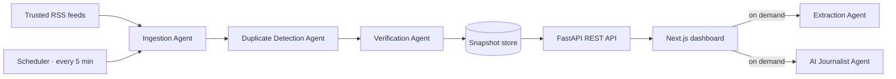

<div align="center">

# NewsPulse AI

**An autonomous, multi-agent newsroom that ingests live RSS from trusted publishers, clusters coverage into events, cross-verifies every story across independent sources, and publishes it to an editorial-grade dashboard.**


</div>

---

## Overview

NewsPulse AI turns raw RSS feeds into a verified, continuously refreshing news product. A pipeline of cooperating agents ingests feeds from publishers such as Reuters, AP, BBC and NPR, removes duplicates, groups overlapping reports into events, and marks an event **Verified** only when two or more independent publishers report it. Readers get full-text articles, credibility scores, grounded AI research briefs, and one-click broadcast-style social graphics.

## Key Features

- **Live coverage**: US, International, and Celebrity (US / UK / CA / AU) sections, refreshed automatically every 5 minutes
- **Cross-source verification**: event clustering with per-publisher credibility scoring
- **Grounded AI research briefs**: strict "cite or omit" prompting, powered by a local model (Ollama) or Google Gemini
- **Social post generator**: 1:1, 9:16 and 16:9 broadcast-style graphics rendered with real typography for pixel-perfect headlines
- **Reader tools**: full-text extraction, PDF export, search, and auto-refresh
- **Resilient by design**: the frontend runs standalone with its own RSS ingestion and falls back gracefully when the backend is unavailable
- **Evaluation harness**: automated checks for de-duplication and clustering that can gate CI

## Architecture



| Agent                        | Responsibility                                                              |
| ---------------------------- | --------------------------------------------------------------------------- |
| **Ingestion**                | Pulls every trusted feed concurrently                                       |
| **Duplicate Detection**      | Removes repeated stories                                                    |
| **Verification**             | Clusters coverage into events and scores independent-publisher agreement    |
| **Extraction**               | Retrieves full article body and hero image on demand                        |
| **AI Journalist**            | Writes a grounded, cited research brief (optional)                          |
| **Image**                    | Supplies post backgrounds for stories without a photo (optional)            |

## Tech Stack

| Layer     | Technology                                                       |
| --------- | ---------------------------------------------------------------- |
| Backend   | Python, FastAPI, httpx, feedparser, BeautifulSoup, Pydantic      |
| Frontend  | Next.js 16 (App Router), React 19, TypeScript, Tailwind CSS 4    |
| AI        | Google Gemini or Ollama (local), Gemini 2.5 Flash Image          |
| Rendering | `next/og` for social graphics, jsPDF for article export          |

## Getting Started

### Prerequisites

- Python 3.11+ and Node.js 20+
- *(Optional)* A [Google Gemini API key](https://aistudio.google.com) or a local [Ollama](https://ollama.com) install

### 1. Backend (recommended)

```bash
cd backend
python -m venv .venv
source .venv/bin/activate          # Windows: .venv\Scripts\activate
pip install -r requirements.txt
cp .env.example .env
uvicorn app.main:app --port 8000
```

Interactive API docs: http://localhost:8000/docs

### 2. Frontend

```bash
cd frontend
npm install
cp .env.example .env.local
npm run dev
```

Open http://localhost:3000.

### 3. Run the evaluation suite

```bash
cd backend
python -m eval.run_eval
```

## Configuration

| Variable                      | Location              | Description                                                         |
| ----------------------------- | --------------------- | ------------------------------------------------------------------- |
| `GEMINI_API_KEY`              | backend & frontend    | Enables Gemini research briefs and generated post backgrounds (optional) |
| `LLM_PROVIDER`                | `backend/.env`        | `gemini` (default) or `ollama`                                      |
| `OLLAMA_URL` / `OLLAMA_MODEL` | `backend/.env`        | Local model settings (default `http://localhost:11434`, `llama3.2`) |
| `REFRESH_INTERVAL`            | `backend/.env`        | Pipeline cadence in seconds (default `300`)                         |
| `FETCH_TIMEOUT`               | `backend/.env`        | Per-feed HTTP timeout in seconds (default `8`)                      |
| `CORS_ORIGINS`                | `backend/.env`        | Comma-separated allowed origins                                     |
| `BACKEND_URL`                 | `frontend/.env.local` | Points the UI at the FastAPI newsroom                               |

Secrets live only in `.env` / `.env.local`, which are git-ignored.

## API Reference

| Method | Endpoint              | Description                                     |
| ------ | --------------------- | ----------------------------------------------- |
| `GET`  | `/api/health`         | Liveness and snapshot availability              |
| `GET`  | `/api/status`         | Pipeline and per-agent status and metrics       |
| `GET`  | `/api/events`         | All events grouped by section                   |
| `GET`  | `/api/us`             | US events, optional `categories` filter         |
| `GET`  | `/api/celebrity`      | Top celebrity events, optional `limit`          |
| `GET`  | `/api/article/{id}`   | Single event with extracted body and brief      |
| `POST` | `/api/refresh`        | Trigger an immediate pipeline run               |

## Project Structure

```
newspulse-ai/
├── backend/                     # FastAPI multi-agent newsroom
│   ├── app/
│   │   ├── agents/              # ingestion, verification, extraction, journalist, image
│   │   ├── config.py            # settings & trusted-publisher registry
│   │   ├── orchestrator.py      # pipeline coordination
│   │   ├── scheduler.py         # periodic refresh
│   │   ├── store.py             # in-memory snapshot store
│   │   └── main.py              # API entry point
│   ├── eval/                    # evaluation harness & fixtures
│   └── requirements.txt
└── frontend/                    # Next.js editorial dashboard
    └── src/
        ├── app/                 # routes, pages & API routes (post generator, newsletter)
        ├── components/          # UI components
        └── lib/                 # feeds, RSS fallback, extraction, verification
```

## License

Distributed under the MIT License. See [`LICENSE`](LICENSE) for details.

## Author

**Ali Hassan** · [LinkedIn](https://www.linkedin.com/in/ali-hassan-70bb9323b) · [GitHub](https://github.com/alihassan-9)
